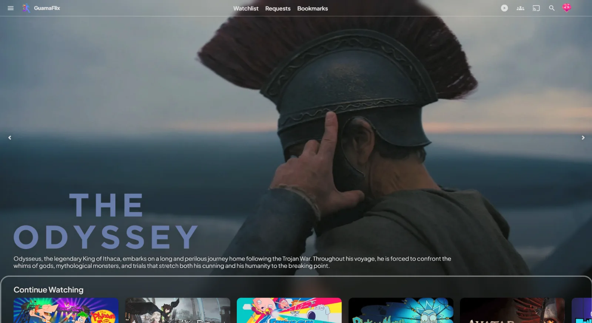
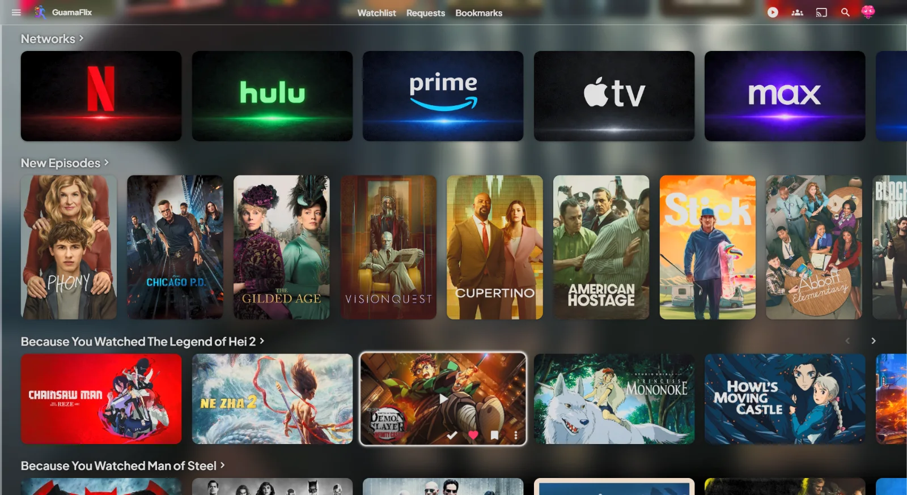
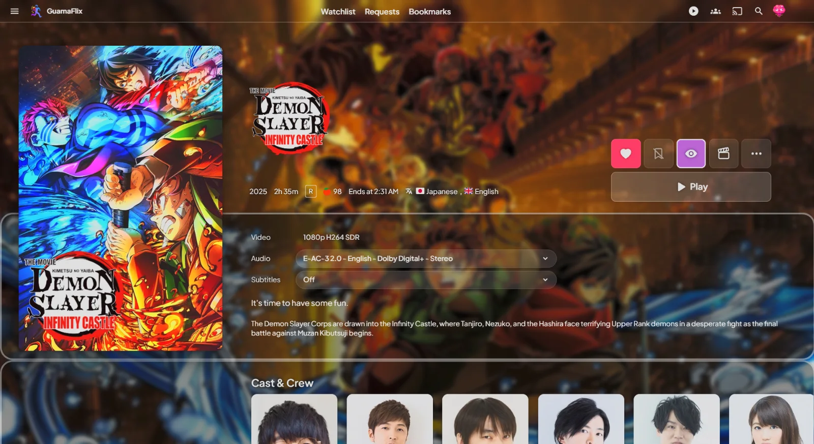
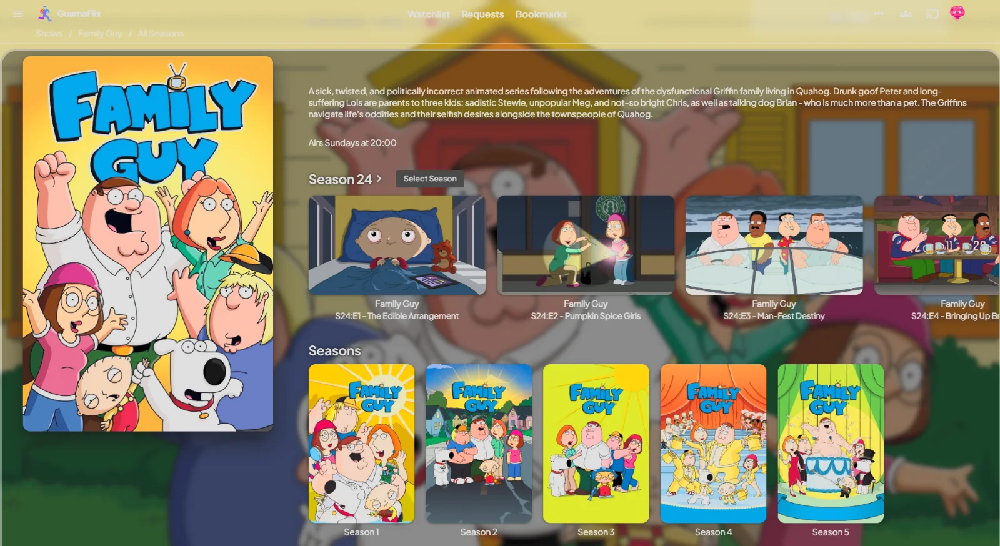
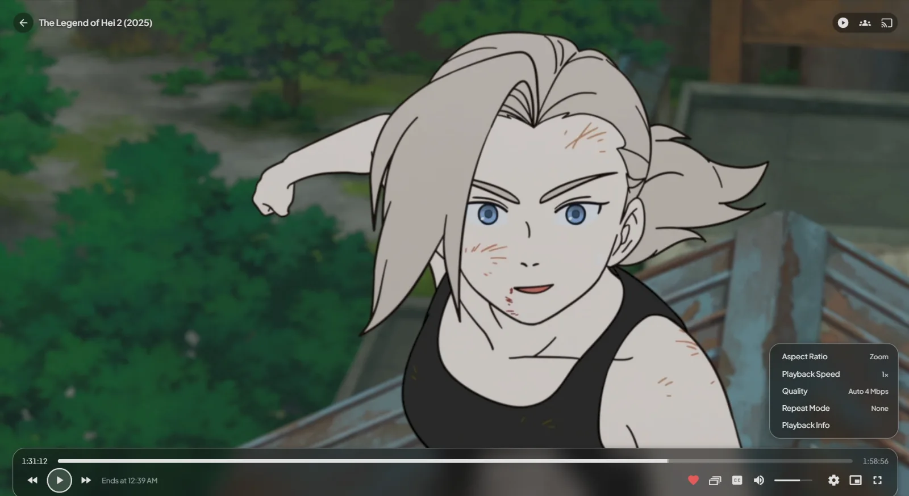
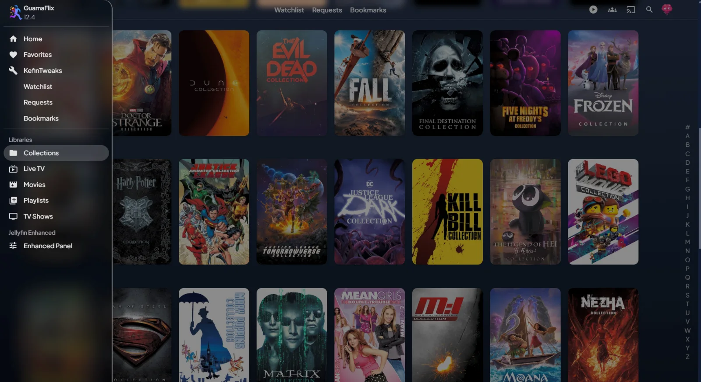
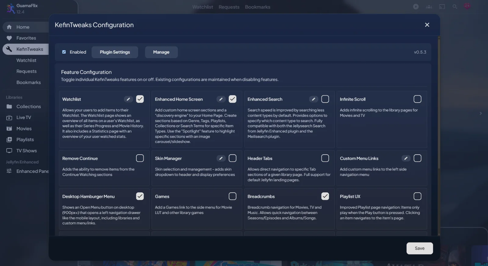

<div align="center">
  

  <h1>Prowlogue for Jellyfin Web</h1>

  
  
  
  <a href="https://prowlogue.app"></a>
  <a href="https://discord.gg/e8A3D9P7fk"></a>
</div>

<p align="center">
  The look and feel of <a href="https://prowlogue.app"><b>Prowlogue</b></a>, the Jellyfin client for Apple TV, in your browser.<br>
  One line to install. Nothing to host. Updates itself.
</p>

<p align="center">
  <a href="#-install"><b>Install</b></a>
  &nbsp;·&nbsp;
  <a href="#-screenshots">Screenshots</a>
  &nbsp;·&nbsp;
  <a href="#-plugins">Plugins</a>
  &nbsp;·&nbsp;
  <a href="#-troubleshooting">Troubleshooting</a>
</p>



## 🚀 Install

1. In Jellyfin, open **Dashboard → Branding**.
2. Paste this line at the very top of **Custom CSS code**:

   ```css
   @import url("https://theme.prowlogue.app/v1/prowlogue.css");
   ```

3. Select **Save**, then reload the page.

That's it. The theme now applies to everyone on your server.

> [!TIP]
> **Not the server admin?** Paste the same line into **Settings → Display → Custom CSS code** instead. It applies to you, in that browser.

> [!IMPORTANT]
> Keep it as the first line. Browsers ignore an `@import` that comes after any other CSS.

### Requirements

| Requirement | Supported |
| --- | --- |
| **Jellyfin** | 12.x |
| **Display mode** | **Auto** (Settings → Display). This is the default. |
| **Theme** | **Dark** (Settings → Display). This is the default. |
| **Browser** | Chrome 105, Safari 15.4 or Firefox 121, or newer |

Everything else keeps the stock Jellyfin look, including the Legacy and TV display modes and the admin dashboard.

### Updates

There's nothing to do. A new release reaches your server the next time a page loads.

## ✨ Features

- **Cinematic Home:** a full-screen Spotlight hero with the title's logo and overview, above rows on a frosted glass panel.
- **Clean posters:** rounded artwork without the clutter. Posters lift and glow on hover, with their actions one click away.
- **Rich detail pages:** artwork fills the screen behind the poster, logo, cast and episodes, with square action buttons above a wide Play button.
- **Floating player:** every control sits in one frosted panel, so the picture stays in view.
- **Frosted everywhere:** menus and the side drawer pick up the colours behind them.
- **Built for phones too:** the same design on a phone, upright or on its side.
- **Smooth loading:** pages ease in and artwork fades in, instead of popping into place.
- **Light:** one stylesheet under 50 KB, with its font built in and no JavaScript. It also respects your system's **Reduce motion** and **Reduce transparency** settings.

## 📸 Screenshots

<table>
  <tr>
    <td width="50%" valign="top">
      <br>
      <b>Home rows</b><br>
      Your library on frosted glass, with a lift and a glow on hover.
    </td>
    <td width="50%" valign="top">
      <br>
      <b>Movies</b><br>
      Full-screen artwork, the title's logo, and everything you need in one place.
    </td>
  </tr>
  <tr>
    <td width="50%" valign="top">
      <br>
      <b>TV shows</b><br>
      Episodes and seasons side by side with the poster.
    </td>
    <td width="50%" valign="top">
      <br>
      <b>Player</b><br>
      A floating frosted panel that keeps the picture in view.
    </td>
  </tr>
  <tr>
    <td width="50%" valign="top">
      <br>
      <b>Libraries and drawer</b><br>
      Poster grids, with a frosted drawer that picks up the art behind it.
    </td>
    <td width="50%" valign="top">
      <br>
      <b>Dialogs</b><br>
      Plugin settings and pop-ups fit right in.
    </td>
  </tr>
</table>

## 🧩 Plugins

The theme works on a plain Jellyfin server. If you run any of these plugins, it styles them too:

| Plugin | What you get |
| --- | --- |
| [Media Bar](https://github.com/IAmParadox27/jellyfin-plugin-media-bar) | The full-screen Spotlight hero on Home |
| [KefinTweaks](https://github.com/ranaldsgift/KefinTweaks) | Its Home rows, Watchlist, breadcrumbs and desktop drawer |
| [Jellyfin Enhanced](https://github.com/n00bcodr/Jellyfin-Enhanced) | Seerr results in search |
| [Home Screen Sections](https://github.com/IAmParadox27/jellyfin-plugin-home-sections) | Its Seerr Discover rows on Home |
| [InPlayerEpisodePreview](https://github.com/Namo2/InPlayerEpisodePreview) | The episode list in the player |

## 🔧 Troubleshooting

<details>
<summary><b>The theme doesn't show up</b></summary>

- Check that the `@import` is the very first line of **Custom CSS code**.
- Check that **Settings → Display → Display mode** is set to **Auto**.
- Check that **Disable server-provided custom CSS code** is turned off in **Settings → Display**.
- Check that your browser meets the [requirements](#requirements). Older browsers keep the stock look.

</details>

<details>
<summary><b>It works locally but not through my reverse proxy</b></summary>

A `Content-Security-Policy` header can block the stylesheet. Add the theme's address to `style-src`, and `data:` to `font-src` for the built-in font:

```nginx
style-src 'self' 'unsafe-inline' https://theme.prowlogue.app;
font-src 'self' data:;
```

Keep the rest of your policy as it is. If only the font is blocked, text falls back to Jellyfin's Noto Sans.

</details>

<details>
<summary><b>I don't see the latest update</b></summary>

Reload the page. A tab that's already open keeps the version it loaded.

</details>

<details>
<summary><b>How do I remove the theme?</b></summary>

Delete the `@import` line from **Custom CSS code**, select **Save**, and reload the page.

</details>

## 🙌 Credits

Inspiration was taken from [Abyss](https://github.com/AumGupta/abyss-jellyfin) by Om Gupta.

## 📜 License

Released under the [MIT License](./LICENSE). You're free to use, change, redistribute and sell this theme, as long as the copyright notice and license stay with it. It comes with no warranty.

The built-in font keeps its own license. See [NOTICE](./NOTICE).

Prowlogue is an independent project and is **not affiliated with or endorsed by** the Jellyfin project.

---

<p align="center"><sub>Prowlogue for Jellyfin Web © 2026 guama.dev · Jellyfin® is a trademark of the Jellyfin project.</sub></p>
